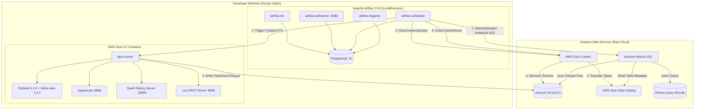

# AWS Data Engineering Local Development Platform Boilerplate

A production-grade, local development boilerplate repository for AWS Data Engineering practice featuring **Apache Airflow 2.9**, **AWS Glue 4.0 (PySpark 3.3 / Delta Lake)**, **AWS Glue Data Catalog**, **Glue Crawlers**, and **Amazon Athena**.

This environment allows you to develop, test, and orchestrate serverless AWS PySpark ETL pipelines locally on Docker, integrating directly with your AWS cloud data lake.

---

## 🏗️ Architecture Overview



---

## 📁 Repository Layout

```text
Airflow-Glue-base-setup/
├── .github/
│   ├── workflows/
│   │   └── ci.yml                   # Automated CI pipeline (lint, DAG integrity, Chispa tests)
│   └── PULL_REQUEST_TEMPLATE.md     # Standardized Pull Request template
├── .env.example                     # Environment variables template
├── .gitignore                       # Git ignore rules for state, data, & secrets
├── docker-compose.yml               # Multi-container orchestration stack
├── README.md                        # Documentation & setup guide
├── docker/
│   ├── airflow/
│   │   ├── Dockerfile               # Extended Airflow 2.9 image with AWS providers
│   │   └── requirements.txt         # Airflow Python dependencies
│   └── glue/
│       ├── Dockerfile               # Extended AWS Glue 4.0 image with Delta Lake & Chispa
│       └── requirements.txt         # PySpark dependencies & test tools
├── docs/
│   └── GIT_WORKFLOW.md              # Detailed Git branching, SSH, and workflow guide
├── dags/
│   ├── sample_glue_pipeline_dag.py      # Standard PySpark S3 ETL DAG
│   └── ecommerce_lakehouse_athena_dag.py# End-to-end Lakehouse DAG (Crawler + Catalog + Athena)
├── glue_jobs/
│   └── sample_etl_job.py                # Production PySpark ETL job script
├── local_data/                          # Local data volume mounts
│   ├── raw/                             # Raw incoming datasets (contains sample_input.csv)
│   ├── processed/                       # Processed / Parquet stage
│   └── curated/                         # Final consumption layer
├── config/
│   ├── aws_credentials.local            # Mock AWS CLI profile for local development
│   └── airflow.cfg                      # Airflow configuration overrides
├── infra/                               # Infrastructure as Code placeholder for future learning
│   ├── environments/                    # Environment-specific deployments (dev, prod)
│   ├── modules/                         # Reusable infrastructure modules
│   └── README.md                        # Infrastructure guide
├── scripts/
│   ├── upload_sample_data_to_s3.sh      # Upload sample mock data to Amazon S3
│   ├── setup_aws_glue_athena.sh         # One-click AWS CLI setup for Catalog, Crawler & Athena
│   ├── run_glue_job.sh                  # Spark-submit launcher for Glue container
│   └── cleanup.sh                       # Environment teardown script
└── tests/
    ├── conftest.py                      # PyTest local SparkSession fixture
    └── test_glue_jobs.py                # Chispa DataFrame unit tests
```

---

## 🚀 Quick Start Guide

### Step 1: Bootstrap the Environment

1. Clone or copy into your workspace and navigate to the project directory:

   ```bash
   cd Airflow-Glue-base-setup
   ```

2. Copy the environment configuration template:

   ```bash
   cp .env.example .env
   ```
   *(Update `.env` with your AWS profile and S3 bucket name)*

3. Start all services using Docker Compose:

   ```bash
   docker compose up -d --build
   ```

4. Verify that all containers are healthy:

   ```bash
   docker compose ps
   ```

Once started:

- **Airflow Web UI**: [http://localhost:8080](http://localhost:8080) (Username: `airflow`, Password: `airflow`)
- **AWS Glue JupyterLab**: [http://localhost:8888](http://localhost:8888)
- **Spark History Server**: [http://localhost:18080](http://localhost:18080)
- **Live Spark UI**: [http://localhost:4040](http://localhost:4040) (active during job execution)
- **Livy REST Server**: [http://localhost:8998](http://localhost:8998)

---

### Step 2: Upload Sample Data & Run the Glue Job

1. Upload the mock transactional records to your Amazon S3 bucket:
   ```bash
   ./scripts/upload_sample_data_to_s3.sh your-real-s3-bucket-name
   ```

2. Run the PySpark ETL job through the runner script:
   ```bash
   ./scripts/run_glue_job.sh sample_etl_job.py
   ```

3. To inspect the generated Parquet files in Amazon S3:
   ```bash
   aws s3 ls s3://your-real-s3-bucket-name/orders_processed/ --recursive
   ```

---

### Step 3: Run PyTest Unit Tests

Unit tests use [`chispa`](https://github.com/MrPowers/chispa) to execute fast, deterministic PySpark DataFrame comparisons without needing a live cluster.

#### Option A: Run inside the Glue container (No local PySpark installation required)

```bash
docker compose exec -T glue-runner pytest /home/glue_user/workspace/tests/ -v
```

#### Option B: Run locally on host (Requires local Python 3.10 with PySpark and Chispa installed)

```bash
pytest tests/ -v
```

---

### Step 4: Run the Pipeline via Apache Airflow

1. Access the Airflow UI at [http://localhost:8080](http://localhost:8080).
2. Unpause the DAG named `sample_glue_pipeline_dag`.
3. Trigger a manual DAG run by clicking the **Play (▷)** button.
4. Inspect the Graph and Task Logs:
   - `check_localstack_s3_prerequisites`: Validates S3 bucket and raw data readiness.
   - `trigger_glue_etl_job`: Executes the PySpark ETL job via `spark-submit`.
   - `verify_processed_output`: Confirms parquet partitions exist in `s3://processed-data-bucket`.

---

### Step 5: Real AWS Cloud Integration (Approach B: Glue Catalog, Crawler & Athena)

When you are ready to connect to real AWS Glue Data Catalog, run AWS Glue Crawlers, and query data in **Amazon Athena**:

#### 1. Setup AWS Cloud Resources (No Terraform Required)

You have two simple options without using Terraform:

##### Method A: One-Command AWS CLI Script (~30 seconds)
Run the automated script with your AWS profile and bucket:
```bash
./scripts/setup_aws_glue_athena.sh giduturi-tutorial-profile ap-south-1 your-real-aws-s3-bucket-name
```
*This automatically creates the Glue database (`ecommerce_db`), IAM Crawler role, Glue Crawler, and Athena Workgroup.*

##### Method B: Via AWS Web Management Console (4 Quick Steps)
1. **Glue Database:** Open AWS Glue Console > **Databases** > Click **Add database** > Name: `ecommerce_db`.
2. **IAM Role:** Open IAM Console > **Roles** > Create role for service **Glue** > Attach policy `AWSGlueServiceRole` and add S3 read access to your bucket.
3. **Glue Crawler:** Open Glue Console > **Crawlers** > Click **Create crawler** > Name: `ecommerce_orders_crawler` > S3 path: `s3://your-bucket/orders_processed/` > Select the IAM role > Output database: `ecommerce_db`.
4. **Athena Output:** Open Amazon Athena Console > **Settings** > Set **Query result location** to `s3://your-bucket/athena_query_results/`.

#### 2. Configure Your `.env` File
In `.env`, set:
```ini
AWS_PROFILE=giduturi-tutorial-profile
AWS_DEFAULT_REGION=ap-south-1
S3_PROCESSED_BUCKET=your-real-aws-s3-bucket-name
GLUE_DATABASE_NAME=ecommerce_db
GLUE_CRAWLER_NAME=ecommerce_orders_crawler
ATHENA_WORKGROUP=primary
```

#### 3. Run the Lakehouse DAG in Airflow
1. Open the Airflow UI at [http://localhost:8080](http://localhost:8080).
2. Trigger the DAG: **`ecommerce_lakehouse_athena_dag`**.
3. Watch the orchestrated sequence execute:
   - **`check_aws_connectivity`**: Validates AWS credentials and S3 reachability.
   - **`run_glue_pyspark_etl`**: Generates transformed Parquet files in S3.
   - **`trigger_glue_crawler`**: Starts the AWS Glue Crawler via `GlueCrawlerOperator`.
   - **`wait_for_glue_crawler`**: Waits for the Crawler to catalog the table (`orders_processed`).
   - **`execute_athena_sales_analysis`**: Runs SQL aggregations via `AthenaOperator`.
   - **`fetch_athena_report`**: Logs calculated business revenue & KPI summary to task logs!

#### 4. Query in the AWS Athena Web Console
Open the [Amazon Athena Query Editor](https://console.aws.amazon.com/athena/):
```sql
SELECT product_category, total_revenue_usd, total_completed_orders 
FROM "ecommerce_db"."orders_processed";
```

---

## 🌿 Git Setup & Collaboration Workflow

A complete developer reference for repository initialization, branching strategy, commit standards, and CI/CD automation:

### 1. Initialize & Connect to GitHub

```powershell
# Navigate to project root
cd D:\Airflow\Airflow-Glue-base-setup

# Initialize local git repository
git init
git branch -M main

# Add remote (SSH recommended)
git remote add origin git@github.com:<your-username>/<your-repo-name>.git

# Initial commit and push
git add .
git commit -m "feat: initial commit with production Airflow, Glue, LocalStack platform"
git push -u origin main
```

### 2. Feature Branching & Development Cycle

We follow a GitHub Flow / Trunk-Based Development model:

- `main`: Protected stable code.
- `feature/<name>`: New ETL pipelines, DAGs, or infrastructure.
- `fix/<name>`: Bug fixes and configuration patches.

```bash
# 1. Pull latest main
git checkout main && git pull origin main

# 2. Branch off
git checkout -b feature/order-aggregation-pipeline

# 3. Develop & run unit tests locally
pytest tests/ -v

# 4. Commit with Conventional Commits (feat:, fix:, test:, refactor:, docs:)
git add .
git commit -m "feat(glue): add order aggregation logic in sample_etl_job"

# 5. Rebase and push
git fetch origin && git rebase origin/main
git push -u origin feature/order-aggregation-pipeline
```

### 3. Automated CI/CD Pipeline

Every Pull Request automatically triggers [`.github/workflows/ci.yml`](.github/workflows/ci.yml):

- **Code Quality**: Syntax & formatting validation (`flake8`, `black`, `shellcheck`, Docker Compose config validation).
- **DAG Integrity**: Automated check verifying all DAGs load cleanly without syntax or import errors.
- **PySpark Tests**: Runs full test suite using `pytest` and `chispa` against PySpark 3.3.0.

> [!NOTE]
> For detailed instructions on SSH key configuration, rebasing, and contributor guidelines, refer to the full [Git Workflow Guide](docs/GIT_WORKFLOW.md).

---

## 🗺️ Future Roadmap & Action Items (Learning Path)

Use this checklist as your step-by-step learning progression after mastering the core local Docker setup:

### 1. CI/CD: Automated Asset Deployment to AWS via GitHub Actions
- [ ] **AWS OIDC Authentication**: Set up secure OpenID Connect (`aws-actions/configure-aws-credentials`) between GitHub Actions and your AWS account to eliminate hardcoded static credentials.
- [ ] **S3 DAG & Script Sync**:
  - Automatically sync [`dags/`](dags/) to your production MWAA / Airflow S3 bucket:
    ```bash
    aws s3 sync dags/ s3://<your-mwaa-bucket>/dags/ --delete
    ```
  - Automatically sync [`glue_jobs/`](glue_jobs/) to your Glue script storage:
    ```bash
    aws s3 sync glue_jobs/ s3://<your-glue-assets-bucket>/scripts/ --delete
    ```
- [ ] **ECR Container Publishing**: Build and publish custom Airflow/Glue images to Amazon Elastic Container Registry (ECR).
- [ ] **Automated Smoke Tests**: Add a GitHub Actions step to trigger a test DAG run via the Airflow REST API on deployment.

---

### 2. Infrastructure as Code (IaC) with Terraform
- [ ] **Implement Core Modules in [`infra/modules/`](infra/modules/)**:
  - **S3 Lakehouse Module**: Provision `raw`, `processed`, and `curated` buckets with server-side encryption (SSE-S3/KMS) and lifecycle transition rules.
  - **Glue Catalog & Crawler Module**: Automate creation of `aws_glue_catalog_database`, `aws_glue_crawler`, and fine-grained IAM service roles.
  - **Athena Module**: Provision `aws_athena_workgroup` with encrypted query output location and query cost limits.
  - **IAM Module**: Least-privilege IAM policies for Airflow workers, Glue ETL jobs, and CI/CD deployers.
- [ ] **Multi-Environment Setup in [`infra/environments/`](infra/environments/)**:
  - Set up `dev/`, `staging/`, and `prod/` workspaces.
  - Configure remote Terraform state storage in Amazon S3 with state locking via DynamoDB.

---

### 3. Production Unit Testing & Data Quality Framework
- [ ] **PySpark Unit Testing with Chispa**:
  - Expand [`tests/test_glue_jobs.py`](tests/test_glue_jobs.py) to cover edge cases: `NULL` fields, corrupted timestamps, zero/negative pricing, and category deduplication.
  - Write test cases for custom PySpark user-defined functions (UDFs) and window aggregations.
- [ ] **Airflow DAG Validation Suite**:
  - Add DAG structure tests: verify all tasks have retries, timeouts, and valid alert emails.
  - Test custom PythonOperator callables in isolation with mock Airflow task contexts (`ti`).
- [ ] **Mock AWS Services with Moto**:
  - Write integration tests for Boto3 S3 upload/download and Glue API triggers using `moto` without touching live cloud resources.
- [ ] **Data Quality Validation (Great Expectations / Soda Core)**:
  - Add automated data contract checks on raw CSV inputs (verifying row counts, non-null IDs, and accepted enum statuses) before allowing downstream Glue ETL processing.

---

## ✂️ Detaching This Template to Start an Isolated Project

When you are ready to use this boilerplate for a new standalone data project:

1. Copy the directory to your target destination:

   ```bash
   cp -r Airflow-Glue-base-setup /path/to/my-new-data-project
   cd /path/to/my-new-data-project
   ```

2. Initialize a fresh Git repository:

   ```bash
   rm -rf .git
   git init
   git add .
   git commit -m "Initial commit from AWS Airflow-Glue boilerplate"
   ```

3. Update `COMPOSE_PROJECT_NAME` in `.env` to avoid container name collisions with other projects:

   ```bash
   sed -i 's/COMPOSE_PROJECT_NAME=de_base_workspace/COMPOSE_PROJECT_NAME=my_custom_project/' .env
   ```

4. Add your custom Glue jobs to `glue_jobs/` and create corresponding DAGs in `dags/`.

---

## 🧹 Teardown and Cleanup

To stop all services and remove orphaned containers:

```bash
./scripts/cleanup.sh
```

To completely reset the environment and wipe all persistent database volumes:

```bash
./scripts/cleanup.sh --volumes
```

---

## 🔧 Environment & Port Reference

| Service | Host Port | Internal Container Port | Description |
| :--- | :--- | :--- | :--- |
| **Airflow Web UI** | `8080` | `8080` | Airflow Webserver Dashboard |
| **Glue Jupyter** | `8888` | `8888` | Interactive JupyterLab environment |
| **Spark UI** | `4040` | `4040` | Live PySpark application diagnostics (active during execution) |
| **Spark History Server** | `18080` | `18080` | Spark UI for all completed jobs & historical execution DAGs |
| **Livy Server** | `8998` | `8998` | Apache Livy Spark REST submission server |
| **PostgreSQL** | `5432` | `5432` | Airflow Metadata Database |
