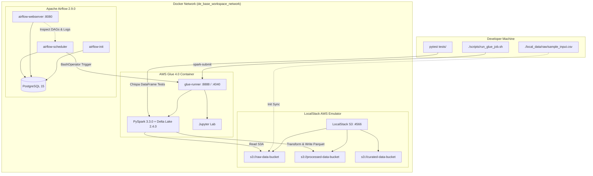

# AWS Data Engineering Local Development Platform Boilerplate

A production-grade, local development boilerplate repository for AWS Data Engineering practice featuring **Apache Airflow 2.9**, **AWS Glue 4.0 (PySpark 3.3 / Delta Lake)**, and **LocalStack S3**.

This environment allows you to develop, test, and orchestrate serverless AWS PySpark ETL pipelines locally on Docker without incurring AWS cloud costs.

---

## 🏗️ Architecture Overview



---

## 📁 Repository Layout

```text
Airflow-Glue-base-setup/
├── .github/
│   ├── workflows/
│   │   └── ci.yml                   # Automated CI pipeline (lint, DAG integrity, Chispa tests)
│   └── PULL_REQUEST_TEMPLATE.md     # Standardized Pull Request template
├── .env.example                     # Environment variables template
├── .gitignore                       # Git ignore rules for state, data, & secrets
├── docker-compose.yml               # Multi-container orchestration stack
├── README.md                        # Documentation & setup guide
├── docker/
│   ├── airflow/
│   │   ├── Dockerfile               # Extended Airflow 2.9 image with AWS providers
│   │   └── requirements.txt         # Airflow Python dependencies
│   └── glue/
│       ├── Dockerfile               # Extended AWS Glue 4.0 image with Delta Lake & Chispa
│       └── requirements.txt         # PySpark dependencies & test tools
├── docs/
│   └── GIT_WORKFLOW.md              # Detailed Git branching, SSH, and workflow guide
├── dags/
│   └── sample_glue_pipeline_dag.py  # Airflow DAG triggering PySpark ETL
├── glue_jobs/
│   └── sample_etl_job.py            # Production PySpark ETL job script
├── local_data/                      # Local data volume mounts
│   ├── raw/                         # Raw incoming datasets (contains sample_input.csv)
│   ├── processed/                   # Processed / Parquet stage
│   └── curated/                     # Final consumption layer
├── config/
│   ├── aws_credentials.local        # Mock AWS CLI profile for local development
│   └── airflow.cfg                  # Airflow configuration overrides
├── infra/                           # Infrastructure as Code (Terraform / CDK / OpenTofu)
│   ├── environments/                # Environment-specific deployments (local, dev, prod)
│   ├── modules/                     # Reusable infrastructure modules (S3, Glue, IAM)
│   └── README.md                    # Infrastructure guide
├── scripts/
│   ├── init_localstack_s3.sh        # Automatic LocalStack S3 bucket initialization
│   ├── run_glue_job.sh              # Spark-submit launcher for Glue container
│   └── cleanup.sh                   # Environment teardown script
└── tests/
    ├── conftest.py                  # PyTest local SparkSession fixture
    └── test_glue_jobs.py            # Chispa DataFrame unit tests
```

---

## 🚀 Quick Start Guide

### Step 1: Bootstrap the Environment

1. Clone or copy into your workspace and navigate to the project directory:
   ```bash
   cd Airflow-Glue-base-setup
   ```

2. Copy the environment configuration template:
   ```bash
   cp .env.example .env
   ```

3. Start all services using Docker Compose:
   ```bash
   docker compose up -d --build
   ```

4. Verify that all containers are healthy:
   ```bash
   docker compose ps
   ```

Once started:
- **Airflow Web UI**: [http://localhost:8080](http://localhost:8080) (Username: `airflow`, Password: `airflow`)
- **LocalStack Health**: [http://localhost:4566/_localstack/health](http://localhost:4566/_localstack/health)
- **AWS Glue Jupyter Lab**: [http://localhost:8888](http://localhost:8888)
- **Apache Spark UI**: [http://localhost:4040](http://localhost:4040) (active during job execution)

---

### Step 2: Run the PySpark Glue Job

The sample ETL job reads raw e-commerce records, formats strings, filters completed transactions, recalculates totals, and writes partitioned Parquet data back to LocalStack S3.

Run the job through the runner script:
```bash
./scripts/run_glue_job.sh sample_etl_job.py
```

To run with custom arguments:
```bash
./scripts/run_glue_job.sh sample_etl_job.py --output_format parquet
```

To inspect the generated Parquet files in LocalStack S3:
```bash
aws --endpoint-url=http://localhost:4566 s3 ls s3://processed-data-bucket/orders_processed/ --recursive
```

---

### Step 3: Run PyTest Unit Tests

Unit tests use [`chispa`](https://github.com/MrPowers/chispa) to execute fast, deterministic PySpark DataFrame comparisons without needing a live cluster.

#### Option A: Run inside the Glue container (No local PySpark installation required)
```bash
docker compose exec -T glue-runner pytest /home/glue_user/workspace/tests/ -v
```

#### Option B: Run locally on host (Requires local Python 3.10 with PySpark and Chispa installed)
```bash
pytest tests/ -v
```

---

### Step 4: Run the Pipeline via Apache Airflow

1. Access the Airflow UI at [http://localhost:8080](http://localhost:8080).
2. Unpause the DAG named `sample_glue_pipeline_dag`.
3. Trigger a manual DAG run by clicking the **Play (▷)** button.
4. Inspect the Graph and Task Logs:
   - `check_localstack_s3_prerequisites`: Validates S3 bucket and raw data readiness.
   - `trigger_glue_etl_job`: Executes the PySpark ETL job via `spark-submit`.
   - `verify_processed_output`: Confirms parquet partitions exist in `s3://processed-data-bucket`.

---

## 🌿 Git Setup & Collaboration Workflow

A complete developer reference for repository initialization, branching strategy, commit standards, and CI/CD automation:

### 1. Initialize & Connect to GitHub

```powershell
# Navigate to project root
cd D:\Airflow\Airflow-Glue-base-setup

# Initialize local git repository
git init
git branch -M main

# Add remote (SSH recommended)
git remote add origin git@github.com:<your-username>/<your-repo-name>.git

# Initial commit and push
git add .
git commit -m "feat: initial commit with production Airflow, Glue, LocalStack platform"
git push -u origin main
```

### 2. Feature Branching & Development Cycle

We follow a GitHub Flow / Trunk-Based Development model:
- `main`: Protected stable code.
- `feature/<name>`: New ETL pipelines, DAGs, or infrastructure.
- `fix/<name>`: Bug fixes and configuration patches.

```bash
# 1. Pull latest main
git checkout main && git pull origin main

# 2. Branch off
git checkout -b feature/order-aggregation-pipeline

# 3. Develop & run unit tests locally
pytest tests/ -v

# 4. Commit with Conventional Commits (feat:, fix:, test:, refactor:, docs:)
git add .
git commit -m "feat(glue): add order aggregation logic in sample_etl_job"

# 5. Rebase and push
git fetch origin && git rebase origin/main
git push -u origin feature/order-aggregation-pipeline
```

### 3. Automated CI/CD Pipeline

Every Pull Request automatically triggers [`.github/workflows/ci.yml`](.github/workflows/ci.yml):
- **Code Quality**: Syntax & formatting validation (`flake8`, `black`, `shellcheck`, Docker Compose config validation).
- **DAG Integrity**: Automated check verifying all DAGs load cleanly without syntax or import errors.
- **PySpark Tests**: Runs full test suite using `pytest` and `chispa` against PySpark 3.3.0.

> [!NOTE]
> For detailed instructions on SSH key configuration, rebasing, and contributor guidelines, refer to the full [Git Workflow Guide](docs/GIT_WORKFLOW.md).

---

## ✂️ Detaching This Template to Start an Isolated Project

When you are ready to use this boilerplate for a new standalone data project:

1. Copy the directory to your target destination:
   ```bash
   cp -r Airflow-Glue-base-setup /path/to/my-new-data-project
   cd /path/to/my-new-data-project
   ```

2. Initialize a fresh Git repository:
   ```bash
   rm -rf .git
   git init
   git add .
   git commit -m "Initial commit from AWS Airflow-Glue boilerplate"
   ```

3. Update `COMPOSE_PROJECT_NAME` in `.env` to avoid container name collisions with other projects:
   ```bash
   sed -i 's/COMPOSE_PROJECT_NAME=de_base_workspace/COMPOSE_PROJECT_NAME=my_custom_project/' .env
   ```

4. Add your custom Glue jobs to `glue_jobs/` and create corresponding DAGs in `dags/`.

---

## 🧹 Teardown and Cleanup

To stop all services and remove orphaned containers:
```bash
./scripts/cleanup.sh
```

To completely reset the environment and wipe all persistent database volumes:
```bash
./scripts/cleanup.sh --volumes
```

---

## 🔧 Environment & Port Reference

| Service | Host Port | Internal Container Port | Description |
| :--- | :--- | :--- | :--- |
| **Airflow Web UI** | `8080` | `8080` | Airflow Webserver Dashboard |
| **LocalStack** | `4566` | `4566` | AWS Local Emulator (S3) |
| **Glue Jupyter** | `8888` | `8888` | Interactive Jupyter Notebook environment |
| **Spark UI** | `4040` | `4040` | PySpark application execution diagnostics |
| **PostgreSQL** | `5432` | `5432` | Airflow Metadata Database |

