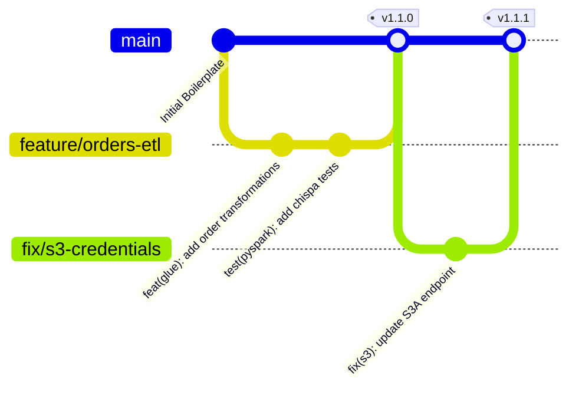

# Git Workflow & Developer Collaboration Guide

This document defines the standardized Git workflow, branching strategy, commit conventions, and CI/CD integration for this AWS Data Engineering repository.

---

## 📌 1. Repository Setup & Connecting to GitHub

### Option A: Initializing a Brand New Local Repository and Pushing to GitHub

```powershell
# 1. Navigate to the project root
cd D:\Airflow\Airflow-Glue-base-setup

# 2. Initialize Git if not already initialized
git init

# 3. Create and switch to the main branch
git branch -M main

# 4. Add your GitHub remote repository (replace with your repo URL)
# Using SSH (recommended):
git remote add origin git@github.com:<your-username>/<your-repo-name>.git
# Or using HTTPS:
# git remote add origin https://github.com/<your-username>/<your-repo-name>.git

# 5. Verify remote connection
git remote -v

# 6. Stage files and create the initial commit
git add .
git commit -m "feat: initial commit with Airflow, Glue PySpark, LocalStack boilerplate"

# 7. Push to GitHub and set tracking upstream
git push -u origin main
```

---

### Option B: Cloning for Future Developers

```bash
# Clone using SSH (Recommended)
git clone git@github.com:<your-username>/<your-repo-name>.git
cd <your-repo-name>

# Or clone using HTTPS
git clone https://github.com/<your-username>/<your-repo-name>.git
cd <your-repo-name>
```

---

## 🔑 2. SSH Key Configuration (Windows & Linux)

If you encounter `Permission denied (publickey)` when pushing or fetching via SSH:

### Step 1: Generate an SSH Key
```powershell
ssh-keygen -t ed25519 -C "your_email@example.com"
```
*Press Enter to accept default location (`~/.ssh/id_ed25519`). Passphrase is optional.*

### Step 2: Copy the Public Key to Clipboard
```powershell
# Windows PowerShell
Get-Content $env:USERPROFILE\.ssh\id_ed25519.pub | Set-Clipboard

# Linux / WSL
cat ~/.ssh/id_ed25519.pub | xclip -selection clipboard
```

### Step 3: Add to GitHub
1. Open [GitHub SSH & GPG Keys](https://github.com/settings/keys).
2. Click **New SSH key**, paste your key, and save.

### Step 4: Verify SSH Connection
```powershell
ssh -T git@github.com
# Expected output: Hi <username>! You've successfully authenticated...
```

---

## 🌿 3. Branching Strategy

We follow a GitHub Flow / Trunk-Based Development model:



| Branch | Description | Direct Commits Allowed? |
| :--- | :--- | :--- |
| `main` | Production-ready stable code. Deployed to production environments. | ❌ No (via Pull Request only) |
| `feature/<name>` | New data pipelines, DAGs, Glue jobs, or infrastructure. | ✅ Yes |
| `fix/<name>` | Bug fixes for ETL jobs, scheduler issues, or configs. | ✅ Yes |
| `refactor/<name>` | Code cleanup, performance optimization, or restructuring. | ✅ Yes |
| `docs/<name>` | Documentation updates. | ✅ Yes |

---

## 🔄 4. Daily Feature Development Lifecycle

### Step 1: Sync `main`
Always pull the latest changes before starting work:
```bash
git checkout main
git pull origin main
```

### Step 2: Create a Feature Branch
```bash
git checkout -b feature/ecommerce-delta-pipeline
```

### Step 3: Implement & Test Changes Locally
- Verify PySpark unit tests:
  ```bash
  pytest tests/ -v
  # Or inside Docker:
  docker compose exec -T glue-runner pytest /home/glue_user/workspace/tests/ -v
  ```
- Run the Glue job locally:
  ```bash
  ./scripts/run_glue_job.sh sample_etl_job.py
  ```

### Step 4: Make Atomic, Conventional Commits
Follow the [Conventional Commits](https://www.conventionalcommits.org/) specification:

Format: `<type>(<scope>): <short summary>`

Types:
- `feat`: New feature or pipeline capability
- `fix`: Bug fix in ETL or DAG logic
- `test`: Adding or updating unit tests
- `refactor`: Code refactoring without behavior change
- `docs`: README or documentation updates
- `chore`: Dependency updates, tooling, or config changes

Examples:
```bash
git add glue_jobs/sample_etl_job.py
git commit -m "feat(glue): implement order status filtering and uppercase formatting"

git add tests/test_glue_jobs.py
git commit -m "test(pyspark): add chispa test for order total recalculation"
```

### Step 5: Keep Your Branch Fresh (Rebase)
Before opening a Pull Request, rebase on top of the latest `main`:
```bash
git fetch origin
git rebase origin/main
```

### Step 6: Push and Open a Pull Request
```bash
git push -u origin feature/ecommerce-delta-pipeline
```
Then navigate to GitHub and open a Pull Request using the pre-configured [PR Template](file:///.github/PULL_REQUEST_TEMPLATE.md).

---

## 🤖 5. CI/CD Pipeline Automation

Every Pull Request triggers automated checks via GitHub Actions ([`.github/workflows/ci.yml`](file:///.github/workflows/ci.yml)):
1. **Linting & Code Quality**: Syntax checks with Flake8 and formatting validation.
2. **Airflow DAG Integrity**: Verifies all DAGs load into Airflow without cycle errors or broken imports.
3. **PySpark Unit Tests**: Executes PyTest and Chispa test suite on Java 11 / PySpark 3.3.

